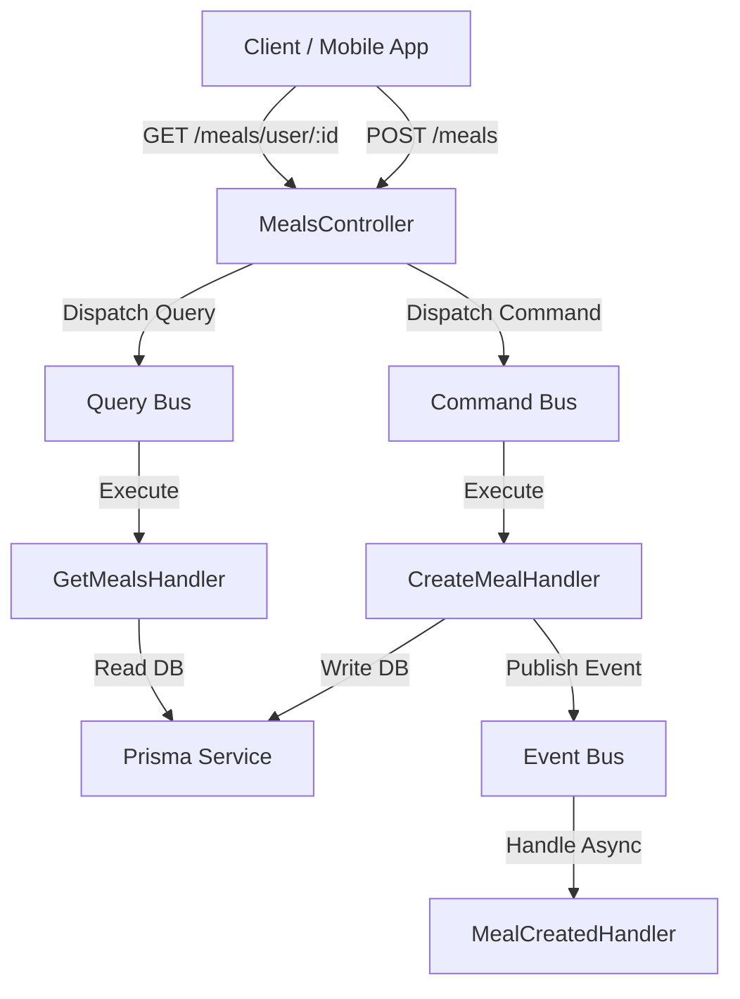

# NutraAI Backend - Hướng dẫn Phát triển

Dự án này là Backend của ứng dụng **NutraAI** (AI-Powered Fitness & Nutrition Tracking), được xây dựng trên nền tảng **NestJS** kết hợp mẫu kiến trúc **CQRS** (Command Query Responsibility Segregation), **Prisma ORM** và **Docker** phục vụ cơ sở dữ liệu PostgreSQL.

---

## 📂 Cấu trúc thư mục dự án

Backend được cấu trúc chuẩn theo mô hình Clean Architecture để dễ dàng mở rộng và bảo trì:

```text
backend/
├── prisma.config.ts        # Cấu hình Prisma CLI (Prisma v7)
├── docker-compose.yml      # Cấu hình Docker chạy PostgreSQL
├── Dockerfile              # Dockerfile build app NestJS đa tầng (multi-stage)
├── src/
│   ├── main.ts             # Điểm khởi đầu của ứng dụng, thiết lập global ValidationPipe
│   ├── app.module.ts       # Module gốc đăng ký ConfigModule, PrismaModule và các module nghiệp vụ
│   │
│   ├── config/             # Cấu hình hệ thống tập trung
│   │   ├── configuration.ts      # Ánh xạ biến môi trường ứng dụng (.env)
│   │   ├── database.config.ts   # Ánh xạ cấu hình kết nối Database
│   │   └── validation.schema.ts # Kiểm tra tính hợp lệ của file .env bằng Zod
│   │
│   ├── common/             # Các lớp tiện ích dùng chung cho toàn bộ ứng dụng
│   │   ├── decorators/     # Decorators tự định nghĩa (Ví dụ: @CurrentUser, @Roles)
│   │   ├── filters/        # Bộ lọc xử lý ngoại lệ (HttpExceptionFilter format JSON lỗi thống nhất)
│   │   ├── guards/         # Lớp bảo vệ route (JwtAuthGuard, RolesGuard)
│   │   ├── interceptors/   # Lớp đánh chặn yêu cầu (LoggingInterceptor đo thời gian, TransformInterceptor chuẩn hóa đầu ra)
│   │   ├── pipes/          # Pipe chuyển đổi dữ liệu (CustomValidationPipe format class-validator thành object)
│   │   └── constants/      # Các hằng số toàn cục (ROLES, API_PREFIX,...)
│   │
│   ├── database/           # Cơ sở dữ liệu và ORM
│   │   └── prisma/
│   │       ├── schema.prisma      # Schema định nghĩa models (User, MealLog)
│   │       ├── prisma.service.ts  # Dịch vụ quản lý kết nối và ngắt kết nối database
│   │       └── prisma.module.ts   # Module toàn cục xuất PrismaService
│   │
│   └── modules/            # Thư mục chứa các chức năng nghiệp vụ (Feature Modules)
│       └── meals/          # Module mẫu quản lý nhật ký ăn uống (Meal Logging) sử dụng CQRS
│           ├── dto/        # Định nghĩa các đối tượng nhận dữ liệu (CreateMealDto)
│           ├── commands/   # Chứa các thay đổi trạng thái (Ghi dữ liệu)
│           │   ├── create-meal.command.ts
│           │   └── create-meal.handler.ts
│           ├── queries/    # Chứa các hành động truy vấn (Đọc dữ liệu)
│           │   ├── get-meals.query.ts
│           │   └── get-meals.handler.ts
│           ├── events/     # Chứa sự kiện không đồng bộ sau khi lệnh thực thi thành công
│           │   ├── meal-created.event.ts
│           │   └── meal-created.handler.ts
│           ├── meals.controller.ts # API Endpoints gọi qua Bus
│           └── meals.module.ts     # Đăng ký Buses & CQRS Handlers
```

---

## 🛠️ Thiết lập môi trường và chạy dự án

### 1. Chuẩn bị biến môi trường
Sao chép file mẫu `.env.example` thành `.env` tại thư mục gốc backend và cấu hình các giá trị phù hợp:
```bash
cp .env.example .env
```
Các biến môi trường cơ bản:
```env
PORT=3000
NODE_ENV=development

POSTGRES_USER=postgres
POSTGRES_PASSWORD=your_secure_password
POSTGRES_DB=nutraai_db
POSTGRES_HOST=localhost
POSTGRES_PORT=5432

DATABASE_URL="postgresql://${POSTGRES_USER}:${POSTGRES_PASSWORD}@${POSTGRES_HOST}:${POSTGRES_PORT}/${POSTGRES_DB}?schema=public"
```

### 2. Chạy cơ sở dữ liệu (PostgreSQL) qua Docker
Đảm bảo **Docker Desktop** đang chạy trên máy của bạn, sau đó khởi động PostgreSQL container:
```bash
docker-compose up -d
```

### 3. Đồng bộ Database Schema (Prisma v7)
Chạy lệnh đẩy cấu trúc bảng trong `schema.prisma` lên cơ sở dữ liệu:
```bash
npx prisma db push
```
*(Nếu muốn tạo file migration lịch sử, dùng lệnh: `npx prisma migrate dev --name init`)*

### 4. Chạy ứng dụng NestJS ở môi trường phát triển
```bash
# Cài đặt các gói phụ thuộc nếu chưa có
npm install

# Khởi chạy chế độ Watch (tự tải lại khi code thay đổi)
npm run start:dev
```

---

## 💡 Mẫu thiết kế CQRS (Command Query Responsibility Segregation)

Dự án sử dụng gói `@nestjs/cqrs` để phân tách rõ ràng giữa tác vụ **Đọc (Queries)** và **Ghi (Commands)**:



### 1. Phía ghi dữ liệu (Write side - Command)
- **Command**: `CreateMealCommand` ôm dữ liệu gửi vào từ DTO.
- **Handler**: `CreateMealHandler` nhận Lệnh, gọi `PrismaService` lưu bản ghi vào PostgreSQL, đồng thời phát một sự kiện không đồng bộ `MealCreatedEvent` qua `EventBus`.
- **Event Handler**: `MealCreatedHandler` lắng nghe sự kiện để chạy các tác vụ nền phụ (như tính toán lại tổng calo ngày qua LLM, gửi cảnh báo,...).

### 2. Phía đọc dữ liệu (Read side - Query)
- **Query**: `GetMealsQuery` ôm tham số lọc (ví dụ `userId`).
- **Handler**: `GetMealsHandler` trực tiếp đọc dữ liệu từ DB qua Prisma với tốc độ tối ưu nhất và trả thẳng về client.

---

## 🔒 Các tiện ích hệ thống (Common Utilities)
- **CustomValidationPipe**: Định dạng lại các lỗi đầu vào từ Class-validator từ dạng mảng phức tạp về dạng Key-Value dễ hiểu cho App Mobile xử lý hiển thị lỗi theo trường:
  ```json
  {
    "statusCode": 400,
    "error": "Bad Request",
    "message": "Validation failed",
    "errors": {
      "calories": ["calories must not be less than 0"]
    }
  }
  ```
- **HttpExceptionFilter**: Bộ lọc ngoại lệ toàn cục định dạng lại toàn bộ lỗi HTTP (404, 401, 500,...) về dạng JSON đồng nhất có trường `timestamp` và `path`.
- **LoggingInterceptor**: Đánh chặn các cuộc gọi HTTP API, ghi nhận log phương thức, URL và thời gian phản hồi (ms) để phục vụ giám sát hiệu năng ứng dụng.
- **JwtAuthGuard & RolesGuard**: Khung sườn phân quyền, xác thực JWT mẫu để tích hợp phân quyền truy cập API.
